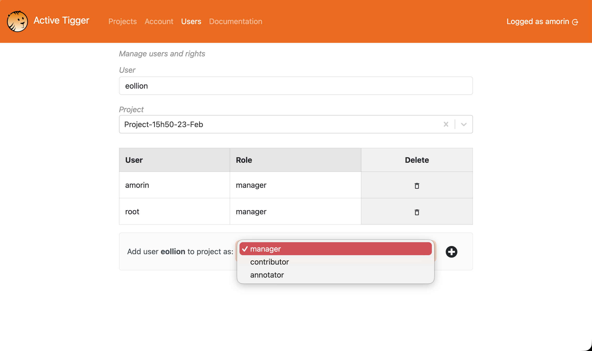

This section describes how to manage your account and collaborations on your projects.

## Account Page

The Account Page allows users to change their password. If you have forgotten your password, check [How can I recover my password?](../faq/faq.md)

You can also manage your API credentials used in the [Generative Page](generative.md), if you have any (experimental). 

Finally, you can find fun statistics about your use of ActiveTigger since your registration.  

## Users Page

This Page allows users to manage collaboration rights across people and projects.

Three roles are defined with different rights: 

- Manager: Default role when creating a project. Managers have access to the data, can annotate, train models, compute features, curate annotation disagreements between users, and delete anything. 
- Collaborator: Collaborators have the same rights as managers but cannot delete anything and cannot curate disagreements.
- Annotator: Annotators can see the [Codebook page](./codebook.md) and the [Explore page](./explore.md) (but they cannot perform any action), and they can access the [Annotate page](./annotate.md) (where they can perform any action except creating or deleting elements).  

Each role is project-dependent and can be managed by the managers of a project. After selecting the appropriate Project, they can type the name of a User and grant them the appropriate rights (select the desired role, then click ).

One last role exists, which is unique and held by the administrator: 

- Root: This user can manage the rights of anyone and has access to **ALL** projects as a manager. Root is also the only one to have access to the [Monitor page](#monitor-page).