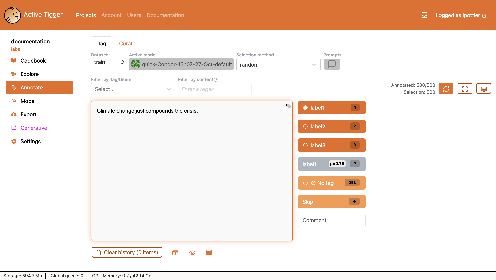
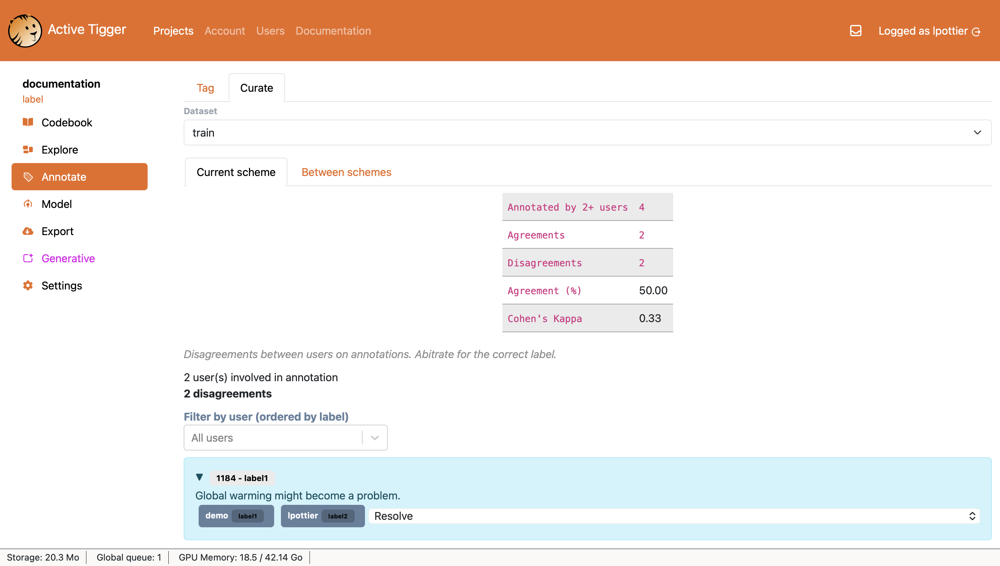
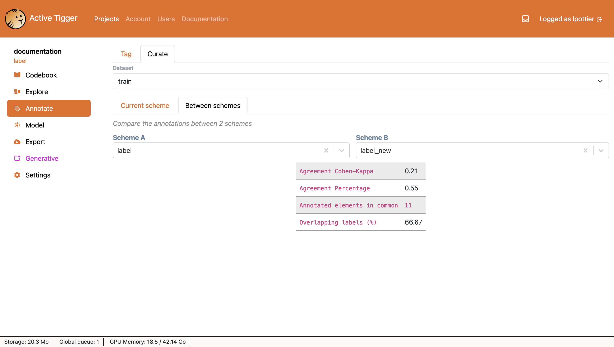

# Annotate page

The Annotate Page is the main page of the app to annotate your data. 

All annotation types share the same layout, with some specificities for multi-label and span annotation that you can find [below](../functionalities/annotate.md#annotate-multi-label). 

## Selecting inputs to annotate

There are several ways to select a subset of inputs.

- Dataset: select the dataset on which you are working (train, validation or test).
- Selection method: change the order in which elements are shown. 
    - fixed (in the order of the original dataset)
    - random
- Active Mode: toggling this mode allows you to choose a model for Active Learning (more about the [concept](../conceptualizing/general.md#what-is-active-learning), more about its [implementation](#active-learning-in-practice)). This unlocks new modes for Selection method: 
    - active: orders the text inputs by decreasing entropy (prioritizing uncertain predictions).
    - active LABEL: orders the text inputs by decreasing entropy with regard to this specific LABEL.
    - max LABEL: orders the text inputs by decreasing probability to be of a given LABEL.
- Prompts: only displays elements matching a specific prompt. Elements are ranked by descending similarity with the prompt. 
    - To activate this mode, type a prompt or Use current text from the annotation box. Select the embeddings used for computing, then Create prompt and exit the window. This unlocks a new Selection method, prompt (embedding), which allows you to select the prompt you have typed.
    - The Max similarity slider allows you to display only the elements with at most the selected similarity with the prompt. Lowering similarity can be helpful to find related but not identical items. 
    - You can view, add or delete prompts in the Prompts window. 
- Filter by Tag/Users: only displays elements with specific characteristics
    - being labeled with LABEL
    - being labeled by a specific user
    - with comments: elements which have a comment
    - wrong prediction: elements for those there is a disagreement between annotation and prediction
- Filter by content: only displays elements matching a search / RegEx expression (more about [RegEx](https://developer.mozilla.org/en-US/docs/Web/JavaScript/Guide/Regular_expressions/Cheatsheet)).
    - To search in the context variables, use `CONTEXT=[your regex]` before the search
    - It is possible to use a query for more complex selection with under the hood [Pandas query](https://pandas.pydata.org/docs/reference/api/pandas.DataFrame.query.html) ; use `QUERY=[your query]`.
- Filter by projection: when inputs are selected via a frame in the [Visualization tab of the Explore page](../functionalities/explore.md#visualization), you can Lock on projection to only display the inputs contained in the frame. 

## Annotation panel

The center of the page displays the text box as well as several buttons. 

- LABEL : tag the input with the given LABEL and move on to the next item.
-  No tag : if a tag exists, remove it and move on to the next input.
- Skip : move on to the next input without altering the annotation.
- Add a comment to your annotation in the comment text box. 
- Click on  to access the Codebook during annotation. 

Most actions can be triggered with hotkeys (1,2,3 .. → or DEL).

If you want the page to only display the Annotation panel, activate  the Focus mode.

### Display parameters

 opens a Configuration modal to modify the annotation panel display.

- Annotation History: if ticked, displays previous annotations of the session.
- Existing annotation: if ticked, displays existing annotation of the current text input.
- Show prediction: if ticked, displays a button for the label predicted by the model (bound to the hotkey "P") when Active Mode is on.
- Show prediction stats: if ticked, displays the model's probability as well as the predicted label (if Active Mode is on).
- Element history: if ticked, displays previous tags of the current text input at the bottom of the text box.
- Mean annotation time: if ticked, displays at the bottom of the screen the mean annotation time for the future annotations performed during the session. If the history is cleared, the annotation time is reset. 
- Tokens: approximate an estimation of text truncation. Given a window size, text inputs exceeding this limit will be written in another color to emphasise possible truncation. This parameter is only visual and has no other impact.
- Height: set the height of the text box.
- Width: set the width of the text box.
- Force bottom labels: if ticked, displays the label buttons horizontally under the text box.
- Force complete labels: if ticked, adapts the label buttons' font size so that the whole label is legible.
- Highlight words in the text: highlights listed words in the input texts (exact matches). 

### Annotation history

The last hundred inputs annotated are visible underneath the annotation panel. For Active Learning to work best, the application retains, at all times, the list of text inputs annotated. This way, unless you Clear history, these elements will not be shown again.

- You can choose to view your annotation history as cards (default) or as a table by clicking on . 
- You can also hide the history without clearing it by clicking on .

!!! warning 
    Changing scheme will automatically clear the history.

### Active Learning in practice

*Read about the concept of [Active learning](../conceptualizing/general.md#what-is-active-learning)*.

In the Annotate page, you can select a model (quick or BERT) to use its predictions for  Active Learning.   This will allow you to see the chosen model's predictions ("guesses") for which category a given element belongs to, allowing you to correct or confirm this prediction by manual annotation. Depending on the Selection method that you have chosen, elements will be ordered by decreasing entropy or decreasing probability (see [selection section](./annotate.md#selecting-inputs-to-annotate)). 

To use BERT models in active learning, you must first compute the predictions on the dataset, in the [Evaluate tab](./model.md#evaluation) Compute statistics on current annotations.

When active learning is on, clicking on  Model name can allow you to:  
 - Retrain quick model, either manually with  Retrain now or every x annotations
 - Change model used for active learning.
 - Deactivate active learning with  Deactivate  

 Models trained on a reduced number of labels can be used, they will simply ignore unseen labels.

!!! tip
    The selection mode Max LABEL is especially useful in the early stages when the model "fails with confidence". This mode selects the elements on which the selected model makes confident predictions, but these may very well be incorrect. You can correct these predictions by correctly labelling elements in this mode, steering the model toward a correct definition of each label. Conversely, the selection mode Active LABEL picks elements on which the model is least confident in its prediction, allowing you to correct it in the same way. Switching between these modes in the annotations phase is often a helpful way to produce a functioning model faster.

## Curate

This tab allows you to see agreements and disagreements in existing annotations, both between several users working on the same scheme and between different coding schemes.

### Current scheme

When several users are working on a given project, the "Current scheme" tab displays information on the progress of annotations as well as on agreements and disagreements between users. Disagreements refer to cases where several users annotating data in a given scheme have annotated the same element differently. 

The first row of the table shows the number of elements annotated by at least two users. In the next three rows, you can find statistics indicating how these annotations are split between agreements or disagreements. The final row displays an interannotator agreement score, [Cohen's Kappa](https://en.wikipedia.org/wiki/Cohen%27s_kappa). The closest it is to 1, the more annotators agree. 

Underneath, you can see how many users are involved in the annotation of the current scheme. To be considered involved, users need to have annotated at least one item in the scheme.    
    
Finally, you can see all disagreements and for each, what user picked what label. Project managers can resolve them by choosing the right label in the dropdown menu and click Validate changes.

### Between schemes

In the "Between schemes" tab, you can compare your annotations across coding schemes.

Select under Scheme A and Scheme B the schemes you want to compare. The table shows four statistics:
- [Cohen's Kappa](https://en.wikipedia.org/wiki/Cohen%27s_kappa): how strongly your two schemes agree, considering only elements that have been annotated in both schemes A and B. The closest it is to 1, the more they agree. 
- Agreement Percentage: how many agreements between your schemes there are, out of the annotated elements in common. 
- Annotated elements in common: number of elements that have been annotated in both scheme A and B. 
- Overlapping labels: how many labels schemes A and B have in common (in %).  

## Annotate (multi-label)

When applying multiple labels to the same element, the general layout is unchanged. To annotate elements, select one or more labels in the dropdown menu and  Validate to save the annotation and move on to the next element.

## Annotate (span)

To annotate the text, first select a LABEL, then highlight the text in the text box. If you want to annotate the other way around (first highlight, then click on the corresponding label), you can select the Highlight first parameter in the  Configuration panel.    

Click on the highlight to remove it.  
       
 Validate the annotation to save the annotation and move on to the next text input.