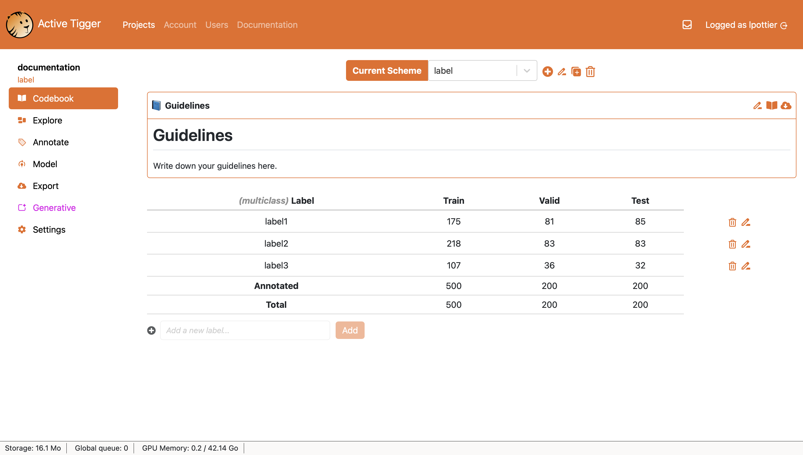

# Codebook Page

This section describes the Codebook page, the key elements and their interactions with the rest of the application.

## Scheme management

At the top of the screen, you will find the [scheme](../conceptualizing/glossary.md#schemes) management component. It consists of a dropdown menu and 4 action buttons. 

- Current scheme : Scheme to use for the current session.
-  to create a new scheme, with a unique name and a type ([see available types](../conceptualizing/glossary.md#schemes))
-  to rename the current scheme.
-  to duplicate the current scheme with all annotations. 
-  to delete the current scheme and its annotations. *This action cannot be undone*.

## Guidelines

The Codebook allows you to keep information on how to use the current scheme. 

-  to enter editing mode (formatted in markdown).
-  to open the Codebook in a browser tab to access it during annotation.
-  to download the Codebook as a markdown file.

## Labels management

The table summarizes existing labels in the current scheme and the distribution of annotations for each dataset (train, validation and test). 

- New label name Add to create a new label.
-  to delete the specific label.
-  to rename the specific label (renaming a label to the name of an existing label will result in merging existing annotations).

The rows can be re-ordered through drag and drop. Reordering rows will change the order of the labels in the [Annotate Page](./annotate.md). 
