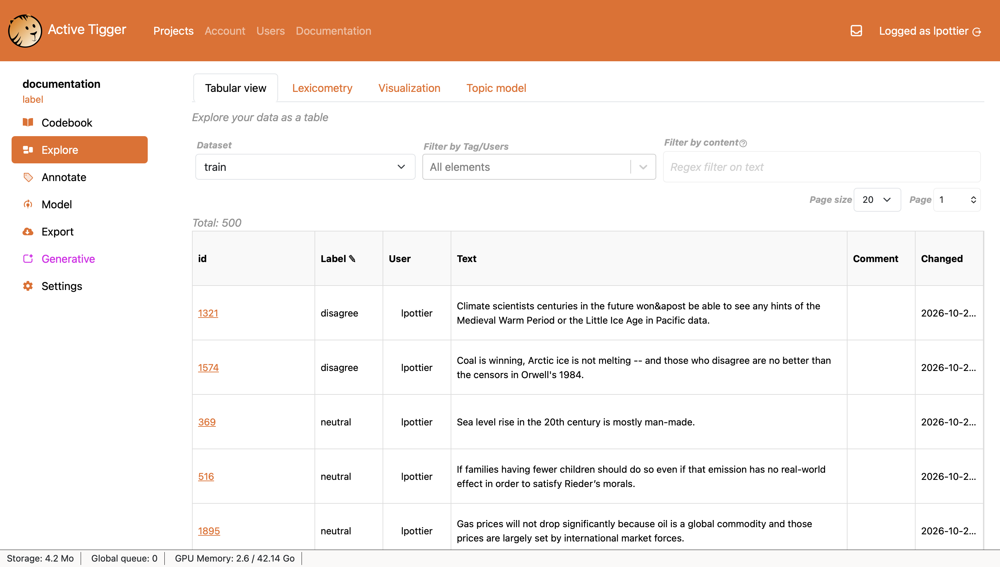
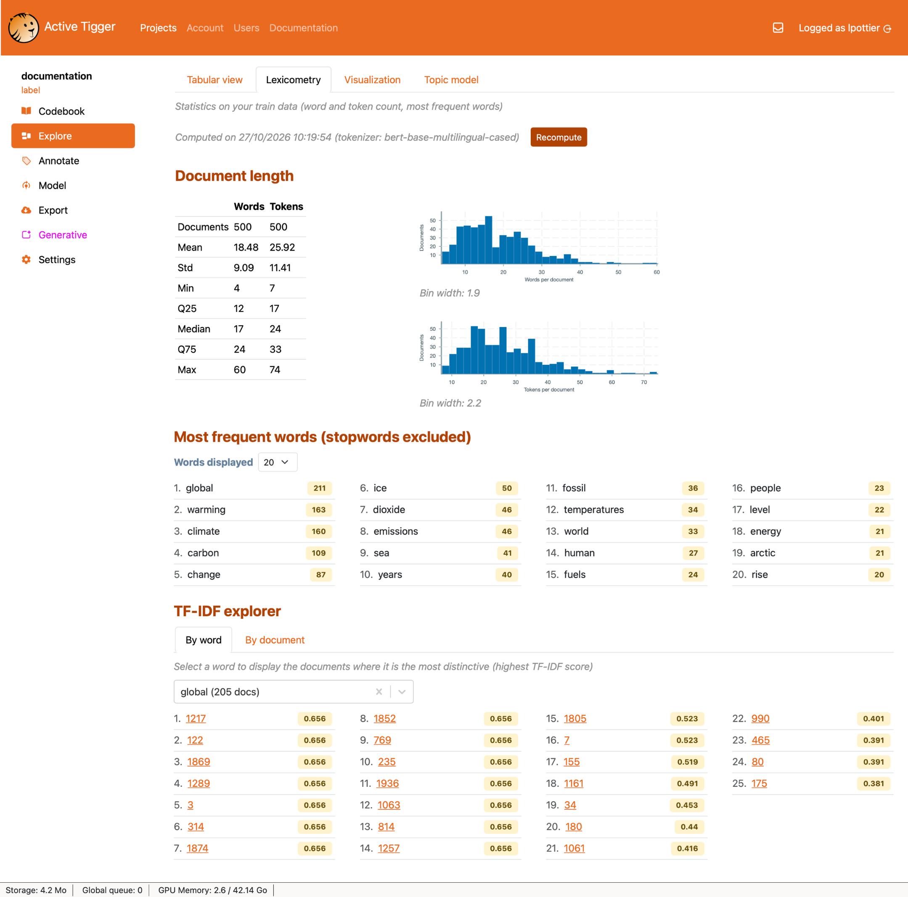
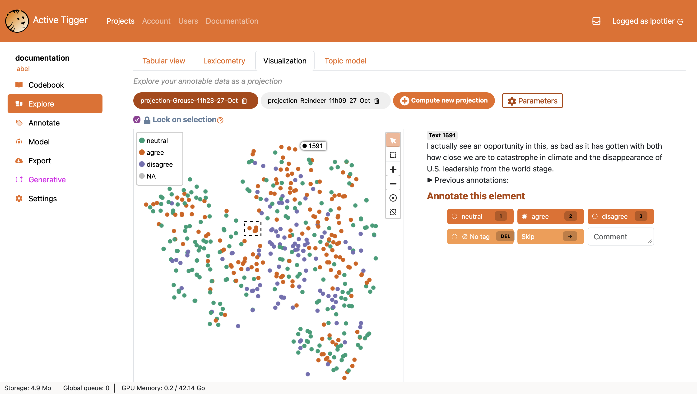
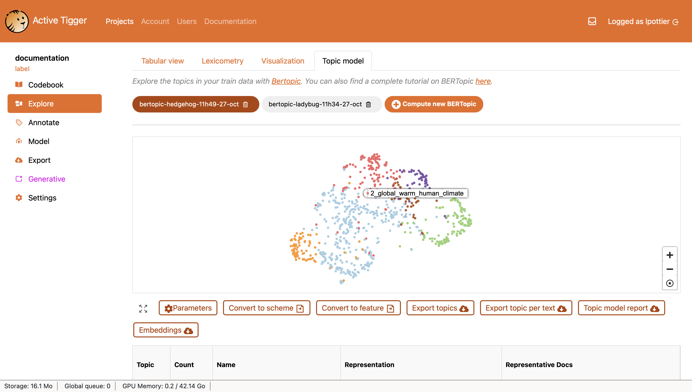

# Explore Page

The Explore panel allows to get an overview of your dataset by visualizing your data as a table and computing statistics, projections and topic modeling.

## Tabular View

The Tabular view displays your data as a table. Filters are available to assist your exploration.

- The table contains 6 columns including the text id, the assigned label, the user who assigned the label, the text, comments (if any), and the date the label was assigned.
    - Click on one id to go to the [Annotate page](./annotate.md) and annotate the selected text input. This is also where you can edit or delete a comment (re-assign the label to save your changes). 
    - Double-click on a label cell to annotate in the tabular view. Click Validate changes to save changes in the database. 
    
- Filters available
    - Select the dataset to explore ("train", "validation" or "test").
    - Select elements with a given label or annotated by a given user. 
    - Select elements given a [regex query](https://medium.com/@victoriousjvictor/understanding-regular-expressions-regex-e1c048f5aa6c).

## Lexicometry

The Lexicometry tab displays various statistics on your "train" data. 

- Document length: This section provides statistics over word and token counts (using the bert-base-multilingual-cased tokenizer). 
    - The table shows descriptive statistics over the set of documents. 
    - The graphs show the distribution of documents according to their length in words (top graph) or tokens (bottom graph). Information on the histogram's bin width is available underneath. 

- Most frequent words (stopword excluded): This section shows the most frequent words across your train set, with their associated frequency count. 

- TF-IDF explorer: This section uses the [TF-IDF measure](https://en.wikipedia.org/wiki/Tf–idf) to display the most significative words in your corpus. TF-IDF scores are computed for each word in each document: a high score means that the word is both highly frequent in the document and rare in the overall corpus.
    - By word: displays the first twenty-five documents where the selected word is the word with the highest TF-IDF score, along with the score. In the Select a word menu, you can see the total number of documents in which a given word has the highest TF-IDF score. 
    - By document: for each document, displays the words that have the highest TF-IDF scores, along with the scores. The table only shows the first fifty documents. You can search for a specific document using its id. 

!!! warning 
    There can only be one lexicometry computation per project.   
    Be aware that recomputing lexicometrics it will overwrite the current computation. 

## Visualization

The Visualization tab displays a [projection](../conceptualizing/general.md#projections) of the embedding space in two dimensions. Projections are computed with either [UMAP](https://pair-code.github.io/understanding-umap/) or [t-SNE](https://en.wikipedia.org/wiki/T-distributed_stochastic_neighbor_embedding). 

- Compute new projection
    - Name: unique name (per project) for the projection.
    - Select a feature: choose the set of feature ([what are features?](../conceptualizing/general.md#representing-texts-with-features)) to use for the projection. If choosing several sets of features, they will be concatenated before projection. Click Add a new feature to [Compute new features](../functionalities/settings.md#features).
    - When Select a model is **UMAP** (default):
        - n_neighbors: defines the size of a neighborhood, hence whether two points are considered as "close" and should be kept together in the process or not.
        - min_dist: aesthetic parameter for how close the kept points should be represented. Low values generate denser representations.
    - When Select a model is **t-SNE**:
        - perplexity: controls the effective number of neighbors that each point considers during the dimensionality reduction process ([more information](https://opentsne.readthedocs.io/en/latest/parameters.html#perplexity)).
    - Feature scaling: this method normalizes the range of independent variables (i.e. each feature) ([should I scale my features?](../faq/faq.md#should-i-scale-my-features)).

- Parameters to see the parameters of the current projection.

- The visualization panel displays each text input in a 2D space. By default, the color of the node depends on the label. However, if an active learning model is selected in the [Annotation page](./annotate.md), you can choose to color the nodes along the predictions of the said model ( Color by: menu). 
    -  to select a subset of text inputs in a frame.
    -  removes the frame.
    - If a frame exists,  Lock on selection to lock on the frame. This will induce the [Annotate page](./annotate.md) to only display elements in the frame. 
    - Clicking a node displays the text input as well as previous annotations and the [Annotation Panel](./annotate.md#annotation-panel), much like in the [Annotation page](./annotate.md)

Projection nodes' coordinates can be downloaded from the [Export page](./export.md#features).

## Topic model

The Topic model section displays existing [topic models](../conceptualizing/general.md#topic-models) on the "train" dataset (for a given project, across all users) and allows to compute new ones with [BERTopic](https://bertopic.com/)[^1]. 

[^1]: Find a full tutorial on BERTopic for the social sciences [here](https://www.css.cnrs.fr/the-general-inquirer-in-the-time-of-llms-a-bertopic-tutorial/).

The visual representation of the topics displays each text input as a node with a color corresponding to the topic generated by the topic model.

- Compute new BERTopic to create a new topic model.
    - Name: unique name (per project) for the computation.
    - Embeddings feature: choose an already-computed sentence-embedding feature. To use a different embedding model, first compute it from [the Features tab of the Settings](../functionalities/settings.md#features). 
    - Number of neighbors: dimension reduction parameter from the[UMAP algorithm](https://pair-code.github.io/understanding-umap/). Low values will generate a topic model focusing on local structures (i.e. very specific topics) whereas higher values will generate a topic model focusing on the overall structure (i.e. general topics) ([more information](https://css-polytechnique.github.io/css-ipp-materials/pages/techy-notes.html#tbl-umap-parameters)).
    - Min topic size: clustering parameter from the [HDBSCAN algorithm](https://scikit-learn.org/stable/modules/generated/sklearn.cluster.HDBSCAN.html). This parameter corresponds to the minimum number of elements in a group to be considered a cluster, otherwise the group is considered as noise. Increasing this value will generate a few large topics, while decreasing this value will generate many small topics.
    - Outlier reduction: if ticked (default), all text inputs considered as noise will be added to the closest topic ([more information](https://css-polytechnique.github.io/css-ipp-materials/pages/techy-notes.html#reduce-outliers-strategies)).
    - Input dataset: which dataset should be used to fit the model (train or train + test + valid).
    - Filter out texts of length lower than: before fitting the model, exclude text inputs of length inferior to this value. 
    - Number of components: dimension reduction parameter from the [UMAP algorithm](https://pair-code.github.io/understanding-umap/). It defines the number of dimensions that the algorithm reduces the embeddings to. Low values flatten the representation of the input texts, whereas higher values maintain a richer representation ([more information](https://css-polytechnique.github.io/css-ipp-materials/pages/techy-notes.html#tbl-umap-parameters)).

- Parameters to see the parameters of the current topic model.
- Convert to scheme to create a [scheme](../conceptualizing/glossary.md#schemes) and assign labels using the topics generated. *Topic-generated labels should be used with caution and carefully reviewed, since they are not based on human annotation*.
- Convert to feature to create a new feature based on the embeddings of the current topic model.
- Export topics to download the topic table displayed underneath (in CSV format).
- Export topic per text to download a mapping of each element id[^2] to the topic index it corresponds to (in CSV format). 
- Topic model report to download an HTML report with key insights (topics description, 2D map, hierarchical representation, representative documents and parameters of the model).
- Embeddings to download the embeddings of the current topic model (in parquet format).

- The table summarises the topic model. 
    - Topic: the topic id.
    - Count: the number of elements in the topic.
    - Name: a standard name for the topic.
    - Representation: a list of keywords that represent the topic.
    - Representative docs: a list of documents that are at the core of the topic generated.

[^2]: As set up when [creating a project](./project-creation.md).
