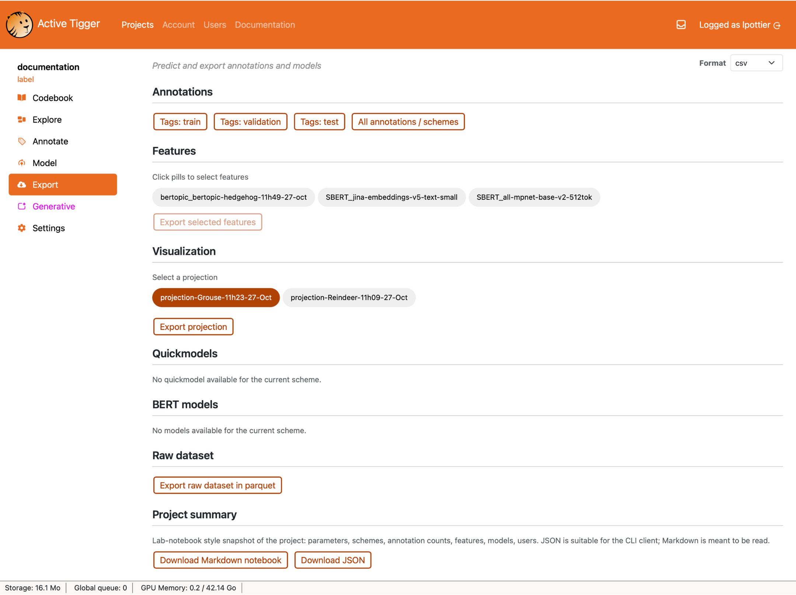

# Export page

On this page, you can export your data, annotations, projections, features and models.      
You can choose your preferred file format (CSV, XLSX or Parquet) in the upper right-hand corner of the page. 

## Annotations

Users can download annotated datasets (train, test, validation or all three).

- Tags: train, Tags: validation, Tags: test : download the annotations from the train, validation or test set of the currently selected scheme. Unannotated text inputs are dropped. 
- All annotations / schemes : download the train, validation and test sets with their annotations for all schemes. Unannotated text inputs are included.

The exported tables contain an ID column, a text column, a dataset column (whose values are train, valid or test), and for each scheme a label column (the annotations), a user column (who made the annotations), a timestamp column (when) and a comment column (the comments that users have written during annotation).

## Features

- Export selected features : download the selected features and the corresponding index (the ID column).

## Visualization 

- Export projection : download the coordinates of the selected projection’s nodes (computed in the [Visualization tab of the Explore page](./explore.md#visualization)) and the corresponding index (the ID column).

## Quickmodels and BERT models

Users can download the predictions computed in the [Prediction tab of the Model page](./model.md) with the selected Quick or BERT model.

- Export prediction complete dataset : download the inferred labels computed by the selected model over the full dataset as imported upon project creation. 
- Export prediction external dataset : download the inferred labels computed by the selected model over the external dataset uploaded in the Prediction tab.
- Export fine-tuned model : download the weights of the fine-tuned BERT model (good practice for reproducibility). This comes under a gzip-compressed TAR file.

## Raw dataset

- Export raw dataset in parquet : download the full dataset as uploaded when creating the project, in parquet format.

## Project summary

Users can download a lab-notebook style snapshot of the project listing the project's raw parameters, as well as information on authorized users, schemes, annotation counts, features and models.

- Download Markdown notebook : download summary in Markdown format (meant to be read).
- Download JSON : download summary in JSON format (suitable for the CLI client). 
