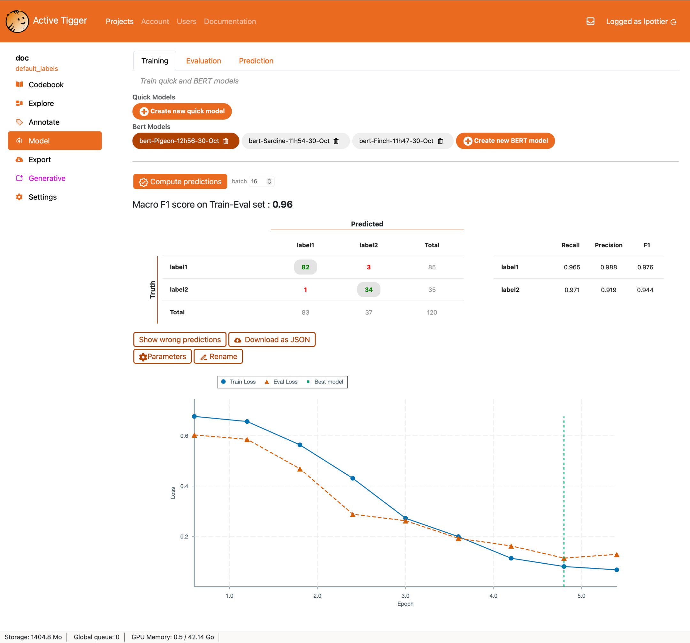

# Model Page

The model panel allows the training and evaluation of models, as well as the final prediction over whole datasets.

## Training

This section describes the Training tab, the parameters available for training as well as the key insights displayed on the page. Every action in this tab is performed on the train dataset, that is the subset of the train set where labels exist. 

 

### Quick Models

The Quick Models are classification models from [scikit-learn](http://scikit-learn.org/stable/supervised_learning.html) trained on pre-computed features ([what are features?](../conceptualizing/general.md#representing-texts-with-features)). They are quick to train and do not require GPUs. These models can be used for [Active Learning](../conceptualizing/general.md#what-is-active-learning) in the [Annotate page](./annotate.md).

When launching a model training, the model will be trained on the subset of the train set where labels exist. For this reason, there must be a few label annotated for each category (around 10). Once trained, the model will predict the labels for the rest of the train set in order to be used in Active Learning (see [Annotation page](./annotate.md#active-learning-in-practice))

Models available include: 

- [Logistic model](http://scikit-learn.org/stable/modules/generated/sklearn.linear_model.LogisticRegression.html) with L2 penalty (default): A linear classifier that combines features with weighted coefficients and applies an L2 (ridge) penalty to keep weights small and reduce overfitting. The parameters are: 
    - Cost: Inverse of regularization strength (scikit-learn's `C`). Lower values mean stronger regularization (smaller weights); higher values fit the training data more closely.
- [Logistic model](http://scikit-learn.org/stable/modules/generated/sklearn.linear_model.LogisticRegression.html) with L1 penalty: Same as above but with an L1 (lasso) penalty, which tends to drive uninformative feature weights exactly to zero (sparse model). Useful for feature selection. The parameters are: 
    - Cost: Same as for L2 — lower values mean stronger regularization.
- [k-Nearest-Neighbors (KNN)](http://scikit-learn.org/stable/modules/generated/sklearn.neighbors.KNeighborsClassifier.html): Classifies input based on the label of the k-nearest neighbors from the trainset. The parameters are: 
    - Number of neighbors: Number of neighbors to look at to choose the label.
- [Random Forest](http://scikit-learn.org/stable/modules/generated/sklearn.ensemble.RandomForestClassifier.html): A collection of Decision Tree classifiers that split the input space to generate a label. The parameters are:
    - Number of estimators: The number of decision trees in the forest.
    - Max features: The number of columns from the embeddings to consider per tree. 
- [Multinomial Naive Bayes classifier](http://scikit-learn.org/stable/modules/generated/sklearn.naive_bayes.MultinomialNB.html): A probabilistic classifier that assumes features are conditionally independent given the label and follow a multinomial distribution. Works well on count-based features (DFM, n-grams). The parameters are:
    - Alpha: Additive (Laplace/Lidstone) smoothing parameter. `0` means no smoothing; higher values smooth probability estimates and reduce the effect of unseen feature/label combinations.
    - Fit prior: If `True`, learn class prior probabilities from the data; if `False`, use a uniform prior.

!!! warning 
    All features are scaled before fitting the Quick Model.
    Features are scaled using the [`StandardScaler` from scikit-learn](https://scikit-learn.org/stable/modules/generated/sklearn.preprocessing.StandardScaler.html#sklearn.preprocessing.StandardScaler)

On top of model-specific parameters, additional parameters can be set: 

- Model name: The name used as a reference in the interface. It must be unique within a project.
- Automatically balance labels: If ticked, the model will be trained on a subset of the train dataset[^2] constructed by picking an equal number of inputs across labels. 
- Train-eval split size: The share of your train set that will be allocated to evaluating the model at every training step.   
- 10-fold cross validation: Computes performance test using the [10-fold cross validation technique](http://scikit-learn.org/stable/modules/cross_validation.html).
- Labels to ignore: Selected labels will be ignored. You need at least two labels to start training a model. Models with ignored labels are available for Active Learning (see [Annotation page](./annotate.md#active-learning-in-practice)). 

<!-- TODO: ADD the retraining process-->

### BERT Models

The BERT Models are pre-trained encoders models with a classification layer [trained with the HuggingFace framework](https://huggingface.co/docs/transformers/tasks/sequence_classification). They can take a dozen minutes to train and require GPUs[^1]. These models can be used for [Active Learning](../conceptualizing/general.md#what-is-active-learning) in the [Annotate page](./annotate.md).

[^1]: You can train on the CPU but that would be sub-optimal.

When launching a model training, the model will be trained on the subset of the train set where labels exist. For this reason, there must be a few label annotated for each category (around 10). After training, the best model (across epochs / checkpoints) will be used to predict the labels on the whole trainset to be used in Active Learning (see [Annotation page](./annotate.md#active-learning-in-practice)).

<!-- TODO Check the save proces -->

The parameters for the model are: 

- Name for the model The name used as a reference in the interface.
- Model base: The pretrained model used for generating the embeddings. Models are loaded through the HuggingFace interface (learn more about model choice [in the FAQ](../faq/faq.md#how-to-account-for-the-specificities-of-my-data-language-language-register-time-period)). 
- Context window size (in tokens): The maximum number of tokens per input that the model can consider. Longer inputs will be truncated to match this size. If selecting Auto adjust Max context window the window size will be set to the length of the longest input of the dataset.
- Epochs: The number of times the model will be trained on the train dataset[^2] ([more on choosing the hyperparameters](../conceptualizing/general.md#which-hyper-parameters-to-choose)). 
- Learning Rate: The learning step value used during training ([more on choosing the hyperparameters](../conceptualizing/general.md#which-hyper-parameters-to-choose)). 
- Weight Decay: The probability for a weight to not be updated during the backward propagation ([more on choosing the hyperparameters](../conceptualizing/general.md#which-hyper-parameters-to-choose)).
- Use GPU: If ticked, the model will be trained on GPU _if available_.
- Batch size: The number of inputs provided to the model at once. Large batch size makes training faster but requires higher tier hardware.
- Gradient Accumulation: The number of batches used to update the weights during the backward propagation. @JULIEN
- Eval: The number of evaluations — scoring performance on the train-eval dataset — performed during training.
- Train-eval split size: The ratio of elements in the train dataset[^2] that will be used to assess the model performance during training.
- Balance labels: If ticked, the train dataset[^2] will be constructed using the same number of text inputs per label.
- Loss: The loss function used to optimise the model weights for training.
- Keep the best model: If ticked, the best model (i.e. the one with the lowest evaluation loss) across epochs/checkpoints is kept instead of the final one.
- Label threshold: The minimum number of annotations per label required.
- Labels to ignore: Inputs with these labels will be dropped out of the train dataset[^2].

Trained BERT models are downloadable from the Export page. Users can download the model files as well as the predictions on the dataset of the project or an external dataset ([learn more on the Export page](./export.md)).

### Key insights

For both classifiers, the application displays the Macro F1-Score as well as the [confusion matrix](https://en.wikipedia.org/wiki/Confusion_matrix) and scores per label ([Recall, Precision](https://en.wikipedia.org/wiki/Precision_and_recall#Precision_vs._Recall) and [F1](https://en.wikipedia.org/wiki/F-score#Definition))

!!! warning

    The performances are computed on the train-eval dataset.

- Show wrong predictions to display the text inputs where the classification failed and compare the prediction with your annotation.
- Download as JSON to download the confusion matrix, scores per label and wrong predictions as a JSON file.
- Parameters to show the parameters of the model and the training arguments.
- Rename to rename the model.

For **BERT models only**, the application displays the [loss curve](https://en.wikipedia.org/wiki/Loss_function) ([how to read the loss curve?](../conceptualizing/general.md#reading-the-loss-curve)).

## Evaluation

The Evaluation tab shows similar components as the [Training](#training) tab. After selecting a classifier, Compute predictions to compute the predictions of the model on the full train, validation and test sets[^2], if they exist. Performance scores are presented similarly as in the [Training tab](#key-insights). 

!!! note

    The predictions over the three datasets have different purposes: those of the train set are given as indication of the model's learning, those of the validation set are used to compare models and improve hyperparameters, and those of the test set are used to evaluate the performance of your final model. Learn more [on the fine-tuning process](../conceptualizing/general.md). 

[^2]: Again, the text inputs with no label are removed from the train, test and validation sets before computing the performance. 

## Prediction

Once you have selected the model with the best performance, you can use the Prediction tab to apply the model to the rest of your data. 

Select the right model, then:
- Predictions on the entire dataset to compute predictions over the data already imported in ActiveTigger but that has not been manually annotated. 
- Prediction on an external dataset to import a dataset (in CSV, XLSX or Parquet format) and compute predictions over this data. 

You can download the predictions in the [Export page](./export.md).

!!! warning
    
    If predictions have already been computed on an external dataset, computing predictions over a new imported dataset will overwrite the current predictions. 