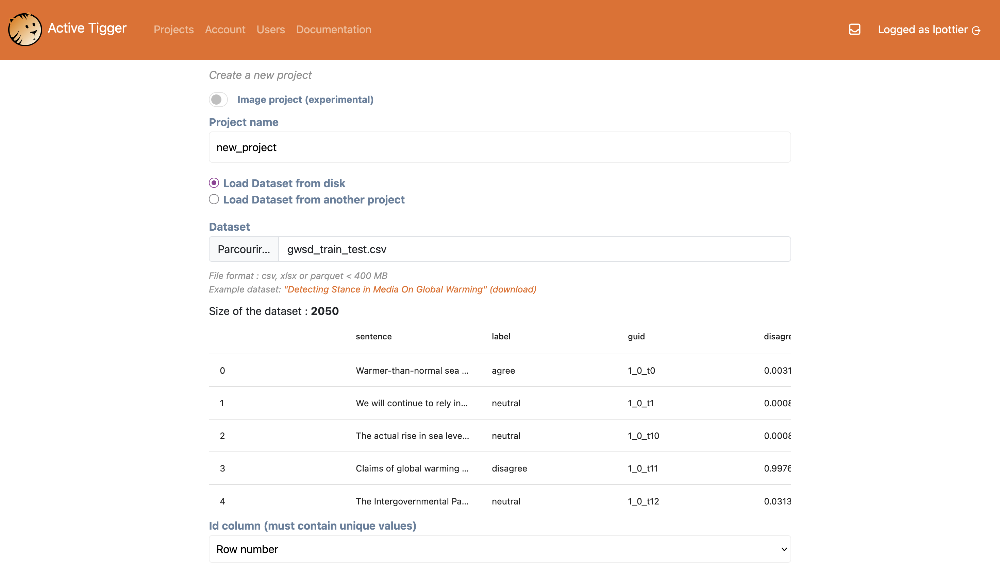

# Project Creation Page

Project creation is available on the Projects page with the New project button. 

## Primary parameters

These parameters define the general project. Some of them cannot be modified after this step (indicated with 🔒) while others can but require some precautions (see footnotes).

- Project name: unique name to identify the project.
- 🔒 Dataset: the data that will be used in the project. It can be:
    - a Parquet, CSV or XLSX file imported by the user (within size limits defined by the administrator). 
    - a dataset from another ActiveTigger project to which the user has access.
- 🔒 Id column: column with a unique identifier. We strongly recommend that you import one, to manipulate your data in and out of ActiveTigger more easily. Otherwise, you can select the row number as id.
- Text column(s): the column(s) to use as text input (the text elements that will be annotated). If several columns are selected, their content will be concatenated using two line-breaks as a separator.
- Language of the corpus: general parameter used to explore the themes of the corpus and suggest which models to use in the treatment. It is possible to work on languages not present in this list: select English as a general setting or contact the administrator to see if the language you are working on can be added to the app. 
- Column(s) for existing annotations (optional): load existing annotations. Each selected column is converted to a new [scheme](../conceptualizing/glossary.md#schemes). 
- Column(s) for contextual information (optional): information available for display to human annotators in the [Annotation page](./annotate.md).
- [^modify-n-rows-trainset] Number of elements in the train set: sample of the original dataset used as train set (learn more about sets [here](../conceptualizing/general.md#train-validation-and-test-sets)).
- [^modify-valid-test-set] Number of elements in the validation set (optional): sample of the original dataset used as validation set (for model comparison and selection). This sample is randomly selected from the original dataset before the train set.
- [^modify-valid-test-set] Number of elements in the test set (optional): sample of the original dataset used as test set (for the final evaluation of the chosen model). This sample is randomly selected from the original dataset before the train set.

[^modify-n-rows-trainset]: You can increase the size of your train set later, by adding N rows to your dataset in [the Parameters tab in the Settings page](./settings.md#parameters). However note that the rows selected _will not follow the stratification rules you set up_. We recommend importing larger datasets than you plan to annotate rather than importing new rows afterwards.

[^modify-valid-test-set]: This parameter cannot be updated per se, but you can drop the validation and/or test sets and import new ones in [the Import tab of the Settings page](./settings.md#import)

After setting the compulsory parameters, clicking the "Create" button will redirect you to the [Codebook page](./codebook.md) (or the [Annotate page](./annotate.md) if you have selected column(s) for existing annotations).

## Secondary parameters

Available in the "Advanced options" panel to configure specific treatments.

- Split by existing column: split the data between train, validation and test sets by selecting an existing column whose values are "test", "valid", or "train". Other values (NULL) are ignored. If a column is selected, other split options are disabled. 
- Select rows at random: if ticked, the train, validation and test sets will be created by picking elements at random. If `Prioritize rows with a label` is ticked, this parameter is ignored.
- Prioritize rows with a label: when loading existing annotations, prioritize annotated elements when selecting the train set. If there are not enough elements annotated to create the whole set, random elements will be picked. 
- Stratify train set: force the [stratification](../conceptualizing/glossary.md#dataset-stratification) for the trainset. If `Prioritize rows with a label` is ticked, this parameter is ignored.
- Stratify valid/test set:  Force the [stratification](../conceptualizing/glossary.md#dataset-stratification) for the valid and test sets. If `Prioritize rows with a label` is ticked, this parameter is ignored.
- Column(s) used for stratification: if `Stratify train set` and/or `Stratify valid/test set` are ticked, the [stratification](../conceptualizing/glossary.md#dataset-stratification) will use the selected column(s). If `Prioritize rows with a label` is ticked, this parameter is ignored.
- Drop annotations for testset: if ticked and columns have been selected for existing annotations, the annotations of elements in the testset will be dropped. 
- Compute sentence embeddings: if ticked, sentence embeddings for the text inputs in the train, validation and test sets will be computed using [Sentence BERT](https://sbert.net/) upon creation of the project.
- Seed: The [seed](https://en.wikipedia.org/wiki/Random_seed) used for all random operations in the project.
