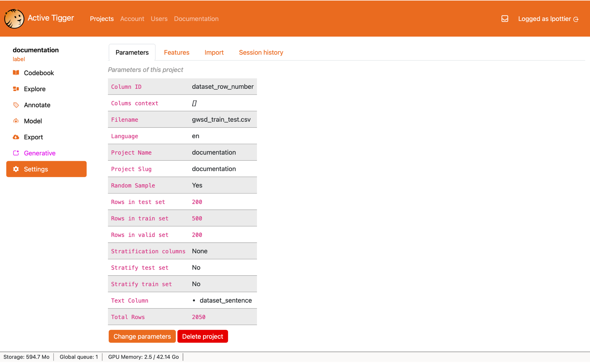
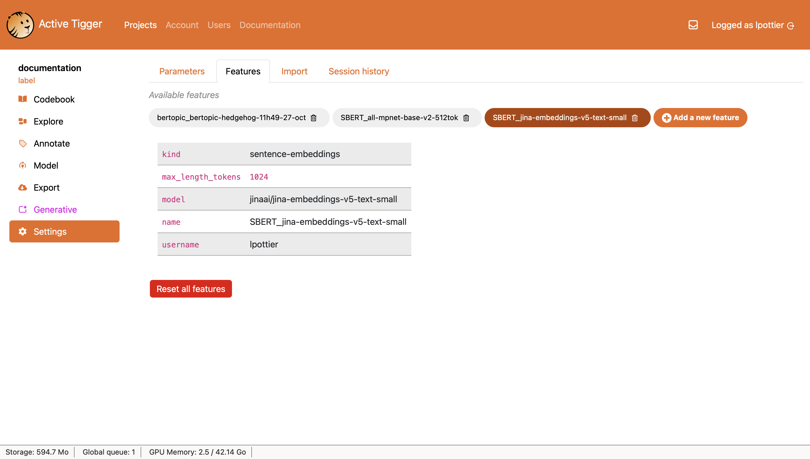
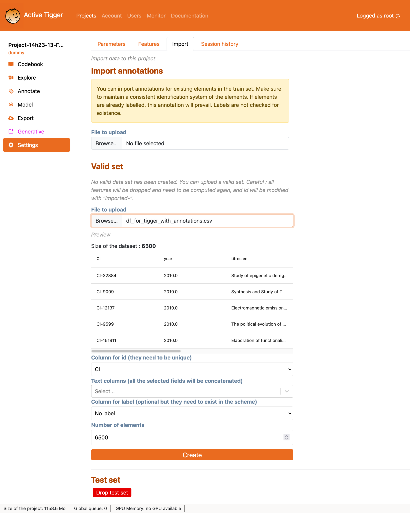

# Settings page

The Settings page contains many tabs with **moderate** to **high impacts** on your project. 

## Parameters

This tab displays the parameters of the project and allows editing of some parameters or deletion of the project. 

- Change parameters to edit some parameters:
    - Project name: [see Project Creation page](./project-creation.md#primary-parameters)
    - Text column(s): [see Project Creation page](./project-creation.md#primary-parameters)
    - Language of the corpus: [see Project Creation page](./project-creation.md#primary-parameters)
    - Column(s) for contextual information: [see Project Creation page](./project-creation.md#primary-parameters)
    - Add N elements in the train set: Pick new elements from the dataset uploaded. *This action ignores stratification*.

!!! note
    
    It is not possible to directly add elements to the test and validation sets. However, you can drop them and import news ones in the Import tab (learn more [in the FAQ](../faq/faq.md#can-i-add-a-test-set-or-validation-set-after-creating-the-project-if-i-havent-already) and get instructions [below](./settings.md#import)). 

- Delete project to delete the project, including annotations and models. 

!!! warning

    Deleting the project is **irreversible**. **It cannot be undone**. 

## Features

Displays the available features and their parameters. 

- Add a new feature to compute new features ([more details on the available features modes](../conceptualizing/general.md#representing-texts-with-features)).
    - if using **sentence or BERT embeddings**:
        - Feature name
        - Model to use
        - Pooling for BERT models: average all token embeddings (mean) or use the CLS token's only. 
        - Max length tokens: the number of token per entry (context window size). After tokenization each input is truncated/padded to match this size.
        - Batch size: number of entries that the model keeps in memory at once.  
    - if using **fasttext** (See the [Features concept](../conceptualizing/general.md#representing-texts-with-features)):
        - Feature name
        - Model to use
    - if using **dfm**: Using `CountVectorizer`
        - Feature name
        - TF-IDF: if set to True, applies TF-IDF.
        - N-grams: the size of n-grams to account for.
        - Min term freq: the minimum frequency for an n-gram to be included in the vocabulary.
        - Max term freq: the maximum frequency for an n-gram to be included in the vocabulary.
        - Norm: if set to True, normalize the features at the end
        - Log: if set to True, apply logarithm function to the features.
    - if using **regex**: creates a boolean feature indicating whether the regex query is found in the text input
        - Feature name
        - Regex query
    - if using **dataset**: imports from a column in the original dataset
        - Column to use
        - Type of the feature: either numerical or categorical.
    - if using **import**: import a pre-computed feature in CSV, XLSX or Parquet format. The file must contain one row per project element, matched on the project's ID. Only numeric columns can be imported.

Features can be downloaded from the [Export page](./export.md#features).

## Import 

The import tab allows you to import data for the current process outside of the [Project Creation page](./project-creation.md). 

- **Import annotations**: import annotations for existing elements in the train dataset. The IDs must match with the IDs in your train set. If the labels differ, new labels will be created. **If annotations already exist, they will be overwritten.**
    - File to upload: Parquet, CSV or XLSX file, limit defined by the administrator.
    - Column for ID: column from the loaded dataset that must match the external IDs from the current text inputs.
    - Column for annotations: column from the loaded dataset that contains the annotations to import.
    - Import annotations to finalise the importation.
- **Validation set** and **Test set**: drop or import the validation or test set.
    - _if a validation/test set exists_, 
        - Drop Test/Validation set: delete the set as well as the features. They will be re-computed.
    - _if the validation/test set does not exist_
        - File to upload: Parquet, CSV or XLSX file, limit defined by the administrator.
        - ID column: index to identify each element in the treatment ; either from an existing column or row number. If the chosen index is not unique, an internal index is created different from the external index.
        - Text column(s): The column(s) to use as text input. If several columns are selected, content of the columns will be concatenated with two linebreaks. 
        - Column(s) for existing annotations (optional): load existing annotations. The column(s) containing the labels must have the same name as the scheme(s) in which the labels and the set will be imported. If labels are not found in the scheme, they will be ignored.
        - Number of elements: number of rows in the set. 

## Session history 

The Session history tab shows the last 100 actions you performed in the project. 